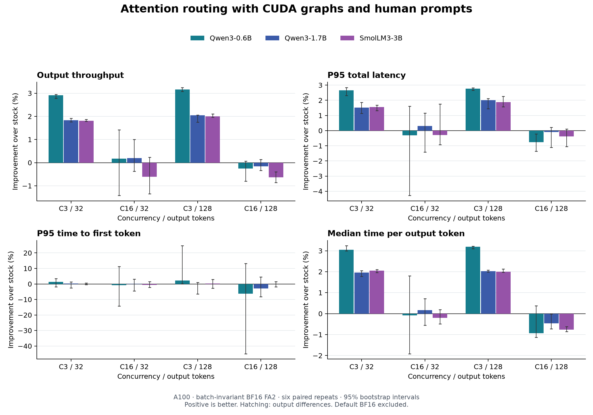

Profiling vLLM on an NVIDIA A100
================================

Code and evidence for **What I Saw from Profiling vLLM on an NVIDIA A100**:
an experiment with KV caching, attention overhead, and small speed improvements.
This repository is a research artifact, not an installable vLLM replacement.

The main finding: a guarded FlashAttention-2 routing change improved throughput
by roughly **1.8–3.2% at concurrency 3** in the tested BF16 batch-invariant
configuration. The benefit mostly disappeared at concurrency 16. Earlier cache
policy experiments did not establish a throughput gain on NVIDIA hardware.

Start with the `final interpretation
<research/08-a100-serving-extension/INTERPRETATION.txt>`_, `correctness checks
<research/08-a100-serving-extension/VALIDATION.txt>`_, and `reproduction guide
<research/08-a100-serving-extension/REPRODUCE.txt>`_.

Final serving results
---------------------

Median paired throughput change versus stock, across six repeats. C is client
concurrency; O is the fixed number of output tokens. Positive means faster.

============ ========= ========= ========= ==========
Model        C3 / O32  C3 / O128 C16 / O32 C16 / O128
============ ========= ========= ========= ==========
Qwen3-0.6B   +2.91%    +3.16%    +0.18%    -0.26%
Qwen3-1.7B   +1.84%    +2.05%    +0.19%    -0.16%
SmolLM3-3B   +1.81%    +2.00%    -0.61%    -0.63%
============ ========= ========= ========= ==========

All six concurrency-3 cells improve in all six repeats, with 95% bootstrap
intervals above zero. Five of the six concurrency-16 intervals cross zero;
SmolLM3-3B with 128-token outputs has a repeatable 0.63% throughput regression.
See `comparison.csv <research/08-a100-serving-extension/comparison.csv>`_ for
absolute measurements, intervals, repeat counts, and all latency metrics.

P95 total latency falls about 1.5–2.8% at concurrency 3. At concurrency 16,
Qwen3-0.6B with 128-token outputs has approximately 0.76% worse p95 total latency.
Time to first token shows no consistent improvement across the study.

What was tested
---------------

* Frozen vLLM v0.31.0 on an NVIDIA A100 PCIe 40GB allocation, BF16,
  batch-invariant FA2, CUDA graphs enabled, tensor parallelism 1.
* The same 96 selected English WildChat prompts for each model, rendered with
  that model's chat template; concurrency 3 and 16, outputs forced to 32 and
  128 tokens. This is a short-heavy controlled workload with human prompts.
* Six paired repeats with alternating stock/optimized order: 36 fresh servers,
  13,824 timed requests, and 1,105,920 generated tokens.
* Experimental cache policies disabled; native prefix caching and chunked
  prefill enabled. KV memory was ample and no preemptions occurred.
* Local HTTP timing includes streaming and detokenization. Tokenization,
  model loading, compilation, and warmup are excluded from request timing.

The `protocol <research/08-a100-serving-extension/PROTOCOL.txt>`_ defines the
settings, sampling, timing, and numerical limits. These are local serving
measurements, not internet-facing latency or a production traffic replay.
Benefits under memory pressure, predominantly long prompts, other hardware,
and broader task workloads remain unestablished.

Correctness and interpretation
------------------------------

In batch-invariant FA2 graph mode, all 96 checked pairs of full API
log-probability vectors matched in value, all 24 natural-response pairs had
identical token sequences, and every timed sequence matched across variants
and repeats. These checks establish equivalence on the tested inputs, not
general task accuracy. All three default BF16 comparisons exceeded the declared
numerical limits and were excluded from timing. Different generated text alone
is not an accuracy score. See `validation
<research/08-a100-serving-extension/VALIDATION.txt>`_ and `default-mode controls
<research/08-a100-serving-extension/DEFAULT-CONTROLS.txt>`_.

The guard routes eligible single-query calls around an FA2 grouping path by
keeping an explicit no-future-tokens window. Direct native checks reduced
CPU-recorded tensor clone counts from two to zero. These are attention-layout
copies, separate from KV-cache block copies. The routing also changes automatic
split-KV availability; batch invariance already forces a single split in the
pinned backend. The study does not isolate every speed change as a pure copying
cost. See the `split-KV analysis
<research/08-a100-serving-extension/NATIVE-SPLIT-KV-NOTE.txt>`_.

A December 2024 output-buffer workaround and a related output-stride proposal
predate this study. This work does not establish a new attention algorithm.
The `related-work review
<research/08-a100-serving-extension/LITERATURE-AND-NOVELTY.txt>`_ includes frozen
sources and hashes. A next experiment would reduce layout copies while
preserving grouped attention and split-KV choices.

Check saved results without a GPU
---------------------------------

From the repository root, using a Python environment managed with uv::

    uv run --no-project --python 3.12 research/08-a100-serving-extension/verify_results.py research/08-a100-serving-extension/evidence --output /tmp/vllm-serving-verification.json

This uses the standard library to check all 36 recorded server results, request
and token counts, timing identities, and output-token parity. It does not rerun
inference or recover archive-only probability tensors.

To regenerate statistical summaries, copy the evidence to a temporary workspace
so the frozen package stays unchanged::

    replay_dir=$(mktemp -d /tmp/vllm-serving-replay.XXXXXX)
    cp -R research/08-a100-serving-extension/evidence/. "$replay_dir/"
    uv run --no-project --python 3.12 --with numpy research/08-a100-serving-extension/summarize.py "$replay_dir"

For fresh A100 runs, follow the `reproduction guide
<research/08-a100-serving-extension/REPRODUCE.txt>`_ and `environment records
<research/02-a100-preflight/RESULTS.txt>`_. Launchers target the recorded
Slurm/RHEL environment and pinned source/native builds. Reuse saved workload
token manifests, including SmolLM3's date-dependent chat template, and admit
only passing numerical modes to timing. Historical Mac constraints are not a
CUDA environment specification.

Follow the experiment
---------------------

The frozen packages preserve protocols, executed-code snapshots, patches,
positive and negative results, and provenance:

* `01 — Baseline freeze <research/01-baseline-freeze/README.txt>`_:
  pinned stock and cache-only candidate sources, capabilities, and CPU checks.
* `02 — A100 preflight <research/02-a100-preflight/RESULTS.txt>`_:
  CUDA environment and source installation checks.
* `03 — Cache correctness <research/03-a100-correctness/RESULTS.txt>`_:
  numerical equivalence, KV copies, eviction, cancellation, reset, and preemption.
* `04 — Cache benchmarks <research/04-a100-benchmarks/INTERPRETATION.txt>`_:
  no established throughput gain; partial reuse worsens first-token latency.
* `05 — Profiling <research/05-a100-profiling/INTERPRETATION.txt>`_:
  cache-management overhead and single-query attention-layout copies.
* `06 — Attention routing <research/06-a100-attention-optimization/INTERPRETATION.txt>`_:
  roughly 6–7.5% throughput gains in the small synthetic eager-mode study.
* `07 — Length/load sweep <research/07-a100-attention-sweep/INTERPRETATION.txt>`_:
  prompt-length and concurrency tests in eager mode with ample KV capacity.
* `08 — HTTP serving <research/08-a100-serving-extension/INTERPRETATION.txt>`_:
  CUDA graphs, WildChat prompts, three models, and conditional 1.8–3.2% gains.

The eager-mode and final graph-mode studies use different settings; their
absolute numbers do not isolate the effect of CUDA graphs.

Historical pilot and repository layout
--------------------------------------

`experiments/INDEX.txt <experiments/INDEX.txt>`_ indexes 14 earlier Apple Silicon
pilot experiments. Their Metal results do not establish CUDA correctness or a
general serving speedup. ``src/``, ``workloads/``, ``tests/``, and ``configs/``
retain pilot drivers and the scheduler trace workflow. The historical
`comparison report <output/pdf/vllm-experiment-comparison.pdf>`_ covers
experiments 1–13; experiment 14 is documented separately.

`experiments/historical-study.patch <experiments/historical-study.patch>`_
preserves the pilot source against official vLLM v0.31.0 commit
``db9527a46873454610df6dbedf79a36d6bf1a7f6``. It is distinct from the corrected
`cache-only candidate <research/01-baseline-freeze/candidate.patch>`_ and the
later attention study. Follow each phase's source preparation instructions.

Evidence availability and attribution
-------------------------------------

Scientific summaries, per-request records, source patches, plots, and executed
code are versioned. Some older compressed diagnostics and full probability
dumps live in separate local/cluster archives and are unavailable in a fresh
clone. The `storage notes <research/public-prep/README.txt>`_,
`older diagnostic inventory <research/public-prep/evidence-storage.json>`_, and
`serving archive map <research/08-a100-serving-extension/raw-evidence-storage.json>`_
describe that boundary. Original inventories also reference such files.

Source checkouts, virtual environments, model weights, binaries, credentials,
and generated run directories are ignored. The `cleanup record
<PUBLICATION-CLEANUP.txt>`_ documents repository maintenance.

This study uses information from WildChat, available under the ODC Attribution
License. See the retained `dataset card
<research/08-a100-serving-extension/upstream/allenai--WildChat--README.txt>`_ and
`license <research/08-a100-serving-extension/upstream/allenai--WildChat--LICENSE.txt>`_.
